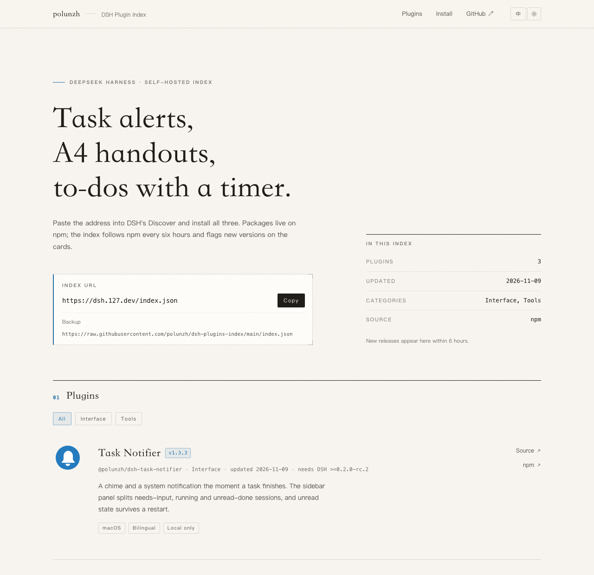
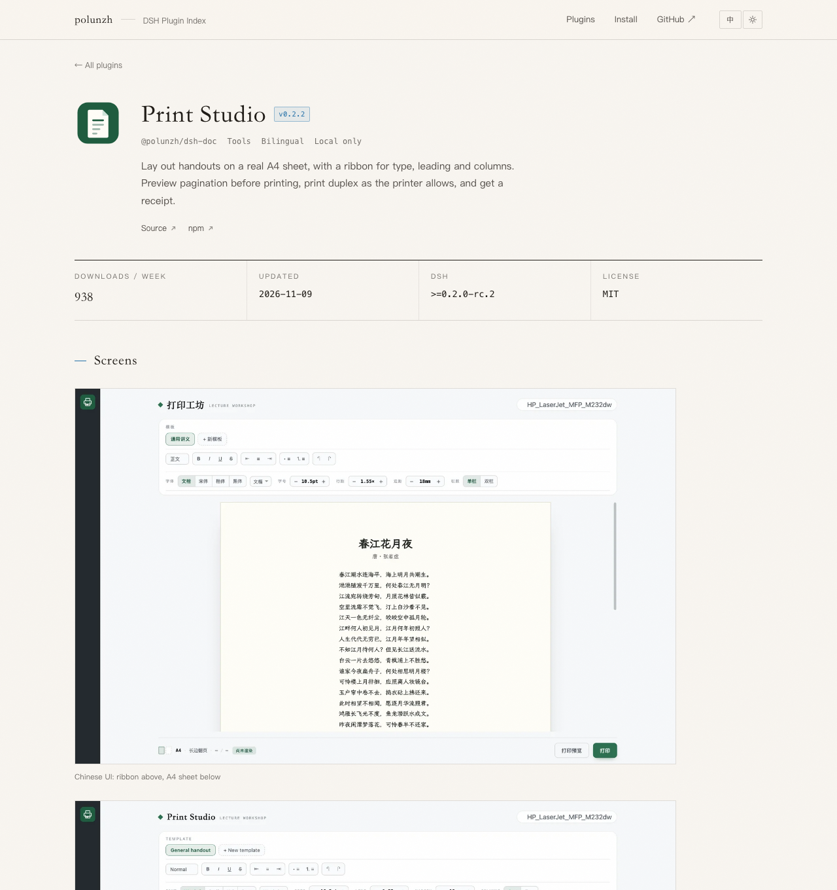

# polunzh DSH Plugins

[中文](./README.zh-CN.md) | **English**

A self-hosted **plugin market index (format 1)** for [DeepSeek Harness (DSH)](https://github.com/deepseek-ai/deepseek-harness), plus the landing page that goes with it.

Add the URL below once to DSH's Discover tab to browse, install, track updates and uninstall the plugins listed here.

```
https://dsh.127.dev/index.json
```

Fallback URL, same content: `https://raw.githubusercontent.com/polunzh/dsh-plugins-index/main/index.json`

> This is a **self-hosted** index covering only polunzh's own plugins. The community market [dshopen.org](https://dshopen.org/) index (`https://dshopen.org/index.json`) can be added at the same time — they do not conflict.



Each plugin also has its own page — screenshots, weekly downloads, install paths and the full version history:



## Plugins

| Plugin | What it does | Latest |
|---|---|---|
| **Task Notifier** · [`@polunzh/dsh-task-notifier`](https://www.npmjs.com/package/@polunzh/dsh-task-notifier) | A chime and a system notification the moment a task finishes; the sidebar panel splits needs-input, running and unread-done sessions, and unread state survives a restart. Bilingual, runs entirely offline. [Source](https://github.com/polunzh/dsh-task-notifier) | 1.3.3 (`index.json` is authoritative) |
| **Print Studio** · [`@polunzh/dsh-doc`](https://www.npmjs.com/package/@polunzh/dsh-doc) | Lay out handouts on a real A4 sheet, with a ribbon for type, leading and columns; preview pagination before printing, print duplex as the printer allows, and get a receipt. Bilingual, rendered and printed locally. [Source](https://github.com/polunzh/dsh-doc) | 0.2.2 (`index.json` is authoritative) |
| **To-do & Pomodoro** · [`@polunzh/dsh-todo`](https://www.npmjs.com/package/@polunzh/dsh-todo) | Todoist-style Today, Upcoming, Inbox and project views, plus a pomodoro bound to tasks; a second-by-second countdown in the sidebar, and an agent `todo` tool over the same task store. Bilingual, local JSON storage. [Source](https://github.com/polunzh/dsh-todo) | 0.1.3 (`index.json` is authoritative) |

## How to use

1. DSH → **Plugins** → **Experimental plugins** → enable **Custom plugin indexes**
2. **Plugins** → **Discover** → **Add index source** → paste the URL above
3. Search or browse in Discover → **Install**
4. Afterwards:
   - **Update**: when a new version exists the entry shows `update-available` (this index refreshes from npm every 6 hours)
   - **Uninstall**: **Plugins** → **Installed** → the plugin → uninstall

> The index only carries metadata (name, description, icon, versions, npm source). Installation is still performed by DSH's plugin manager against the real npm package; the index hosts no code or tarballs.

## How it stays current

- Sources: `plugins.json` (hand-maintained metadata) + the **npm registry** (versions, publish timestamps, `engines.dsh`)
- `scripts/build-index.mjs` writes `index.json` and validates it with the official validator `@deepseek-ai/dsh-plugin-market-index`; nothing is written if validation fails
- `scripts/build-page.mjs` turns `index.json` + `site.json` into a single self-contained `dist/index.html` (CSS, JS and icons inlined, no external requests). The page also re-reads `/index.json` on load, so an index refresh shows up without rebuilding it
- `npm run build` also asks the npm downloads API for each plugin's weekly downloads, so the detail pages carry a number even without JavaScript
- GitHub Actions runs every 6 hours and commits only when something changed; `workflow_dispatch` is available too
- Net effect: **publish a new npm version → it appears in the index and on the page within 6 hours**

## Hosting

`https://dsh.127.dev/` is served by the Cloudflare Worker in this repo (`worker/index.js` + `wrangler.toml`):

- `/` or `/index.html` → the landing page (plugin detail pages are client-side routes, `#/plugin/<slug>`)
- `/index.json` → the market index
- `/assets/*` → screenshots, favicons (7-day edge cache)
- `/api/downloads?pkg=…` → npm weekly downloads, proxied and cached for an hour
- anything else → 404

Both are read from GitHub per request and cached at the edge for 5 minutes. Refreshing the index or the page needs no Worker redeploy; `npx wrangler deploy` is only needed when the Worker code changes.

## Build and validate locally

```bash
npm install          # install the official validator
npm run build        # fetch latest from npm, rewrite index.json and dist/index.html
npm run check        # validate index.json and confirm dist/index.html is up to date (offline)
```

The page also takes `?lang=en|zh` and `?theme=light|dark` for quick previews of either version.

## Adding a plugin

1. Drop an icon at `icons/<slug>.svg` (≤32 KiB; SVG/PNG/JPEG/WebP; inlined as a `data:` URL at build time)
2. Add an entry to the `plugins` array in `plugins.json`:

```json
{
  "name": "@polunzh/dsh-your-plugin",
  "author": "polunzh",
  "icon": "icons/your-plugin.svg",
  "category": "interface",
  "keywords": ["your", "keywords"],
  "labels": ["bilingual"],
  "sortKeys": { "added": 2 },
  "homepage": "https://github.com/polunzh/dsh-your-plugin#readme",
  "repository": "https://github.com/polunzh/dsh-your-plugin",
  "title": { "en": "Your Plugin", "zh": "你的插件" },
  "description": { "en": "…", "zh": "…" }
}
```

3. Optional but recommended: give the plugin a detail page by adding a `detail` block to its entry — `license`, bilingual `features`, and `screenshots` pointing at files under `assets/shots/<slug>/` (WebP, ~1400 px wide, with width/height and a bilingual caption):

```json
"detail": {
  "license": "MIT",
  "features": { "en": ["…"], "zh": ["…"] },
  "screenshots": [
    { "src": "assets/shots/your-plugin/panel.webp", "w": 1400, "h": 875, "en": "…", "zh": "…" }
  ]
}
```

4. `npm run build` → commit `plugins.json`, the icon, any screenshots, `index.json` and `dist/index.html`

Constraints (enforced by the official format 1 validator during the build):
`name` must be a valid npm package name; `versions` must be non-empty with exact SemVer versions and Unix-second publish timestamps;
every `category` / `labels` / `sortKeys` id must be declared in `metadata`; `title` must contain `en`; inline icons must stay under 32 KiB.
Prerelease versions are excluded by default (for example the `0.0.0-stage` placeholder left behind by npm's staged publishing flow).

Page copy and links live in `site.json`; category filters on the page appear automatically once more than one category is in use.

## License

[MIT](./LICENSE). `index.json` and `dist/index.html` are generated data and may be referenced freely.
