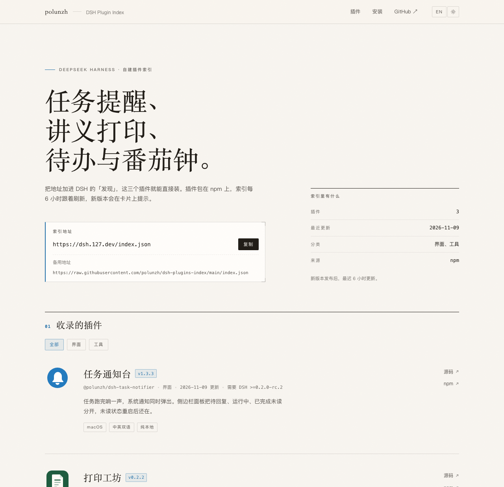

# polunzh DSH Plugins

**中文** | [English](./README.md)

给 [DeepSeek Harness（DSH）](https://github.com/deepseek-ai/deepseek-harness) 用的**自建插件市场索引（format 1）**，以及配套的落地页。

把下面这一个 URL 加进 DSH「发现」，就能浏览、安装、检测更新、卸载本仓库收录的插件。

```
https://dsh.127.dev/index.json
```

备用地址，内容相同：`https://raw.githubusercontent.com/polunzh/dsh-plugins-index/main/index.json`

> 这是**自建索引**，只收录 polunzh 自研的插件；社区市场 [dshopen.org](https://dshopen.org/zh/) 的索引 `https://dshopen.org/index.json` 可以同时添加，互不冲突。



## 收录的插件

| 插件 | 说明 | 最新版 |
|---|---|---|
| **任务通知台** · [`@polunzh/dsh-task-notifier`](https://www.npmjs.com/package/@polunzh/dsh-task-notifier) | 任务完成时响提示音并弹系统/浏览器通知；侧边栏「任务」面板可筛选已完成未读 / 运行中 / 已完成 / 全部，未读状态本地持久化。中英双语，纯本地不联网。[源码](https://github.com/polunzh/dsh-task-notifier) | 1.2.1（以 `index.json` 为准） |

## 怎么用

1. DSH → **插件** → **实验性插件** → 启用 **自定义插件索引**
2. 回到 **插件** 页 → **发现** → **添加索引源** → 粘贴上面的 URL
3. 在「发现」里搜索或浏览 → **安装**
4. 之后：
   - **更新**：插件有新版本时，列表会显示 `update-available`（本索引每 6 小时随 npm 刷新）
   - **卸载**：**插件** → **已安装** → 对应插件 → 卸载

> 索引只提供元数据（名称、简介、图标、版本、npm 源）。安装动作仍然由 DSH 的插件管理器执行，装的是 npm 上的真实包，索引本身不托管任何代码或 tarball。

## 更新机制

- 数据源：`plugins.json`（人工维护元数据）+ **npm registry**（版本号、发布时间、`engines.dsh`）
- `scripts/build-index.mjs` 生成 `index.json`，**先过官方校验器** `@deepseek-ai/dsh-plugin-market-index`，失败不写文件
- `scripts/build-page.mjs` 把 `index.json` + `site.json` 编成单文件自包含的 `dist/index.html`（CSS、JS、图标全部内联，不发任何外部请求）
- GitHub Actions 每 6 小时跑一次，只有内容变化才提交；也可以手动 `workflow_dispatch`
- 因此：**发 npm 新版本 → 最迟 6 小时自动出现在索引和落地页里**

## 托管方式

`https://dsh.127.dev/` 由仓库里的 Cloudflare Worker（`worker/index.js` + `wrangler.toml`）提供：

- `/` 或 `/index.html` → 落地页
- `/index.json` → 市场索引
- 其余路径 → 404

两者都按请求实时读取 GitHub 上的文件，边缘缓存 5 分钟。刷新索引或页面无需重新部署 Worker；只有 Worker 代码变更时才需要 `npx wrangler deploy`。

## 本地构建 / 校验

```bash
npm install          # 安装官方校验器
npm run build        # 抓 npm 最新版本，重写 index.json 和 dist/index.html
npm run check        # 校验 index.json，并确认 dist/index.html 与数据一致（不联网）
```

页面支持 `?lang=en|zh` 与 `?theme=light|dark`，方便快速预览两种版本。

## 新增一个插件

1. 把图标放到 `icons/<slug>.svg`（≤32 KiB，SVG/PNG/JPEG/WebP，构建时内联为 `data:` URL）
2. 在 `plugins.json` 的 `plugins` 数组里加一项：

```json
{
  "name": "@polunzh/dsh-your-plugin",
  "author": "polunzh",
  "icon": "icons/your-plugin.svg",
  "category": "interface",
  "keywords": ["your", "keywords"],
  "labels": ["bilingual"],
  "sortKeys": { "added": 2 },
  "homepage": "https://github.com/polunzh/dsh-your-plugin#readme",
  "repository": "https://github.com/polunzh/dsh-your-plugin",
  "title": { "en": "Your Plugin", "zh": "你的插件" },
  "description": { "en": "…", "zh": "…" }
}
```

3. `npm run build` → 提交 `plugins.json`、图标、`index.json` 和 `dist/index.html`

约束（与官方 format 1 一致，构建脚本会强制校验）：
`name` 必须是合法 npm 包名；`versions` 非空、版本号是精确 SemVer、发布时间是 Unix 秒；
`category` / `labels` / `sortKeys` 引用到的 id 必须先在 `metadata` 里声明；
`title` 必须含 `en`；图标内联不超过 32 KiB。默认**不收录预发布版本**（如 npm 发布流程留下的 `0.0.0-stage`）。

页面文案与链接在 `site.json` 里；分类筛选条会在出现第二个分类后自动显示。

## License

[MIT](./LICENSE)。`index.json` 与 `dist/index.html` 是生成产物，可自由引用。
