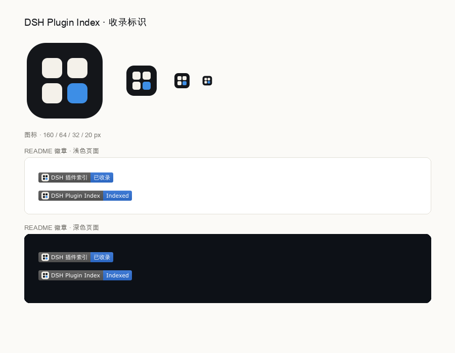

# 收录标识（README badge）



插件被收录进这个索引之后，在插件自己的 README 里挂一枚标识，读者一眼能看出它在这个索引里，点进去就是站点。

## 资源

| 文件 | 尺寸 | 用途 |
|---|---|---|
| `assets/index-mark.svg` | 64×64 | 索引的图标本体，用于 favicon 之外的场合（README 头部、社交预览） |
| `assets/badge-zh.svg` | 148×20 | 中文 README 的徽章 |
| `assets/badge-en.svg` | 185×20 | 英文 README 的徽章 |

两个徽章由 Worker 从 `/assets/*` 直接提供，推送后即可用：

- `https://dsh.127.dev/assets/badge-zh.svg`
- `https://dsh.127.dev/assets/badge-en.svg`

## 片段

英文 README：

```markdown
[](https://dsh.127.dev/)
```

中文 README：

```markdown
[](https://dsh.127.dev/)
```

放在 npm 徽章之后、license 之前，和其他徽章同一行。

## 设计

四格目录 + 右下一格强调蓝，和站点 favicon 同一套记号：三格奶油色是已经收录的条目，蓝色那一格是刚被收录进来的这一项。深色底在浅色页面上有轮廓，奶油色盘在深色徽章里也有轮廓，所以两处都不需要额外的描边。

徽章本身是静态 SVG，不走 shields.io：shields 会把自定义 logo 统一染成白色，蓝格子会丢。左侧沿用 shields 的 `#555555`，和同一行里的 npm、license 徽章齐平；右侧 `#2f6fd0`，白字对比度 4.9:1，够 AA。
